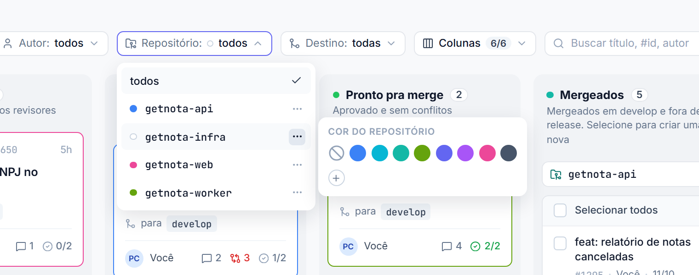
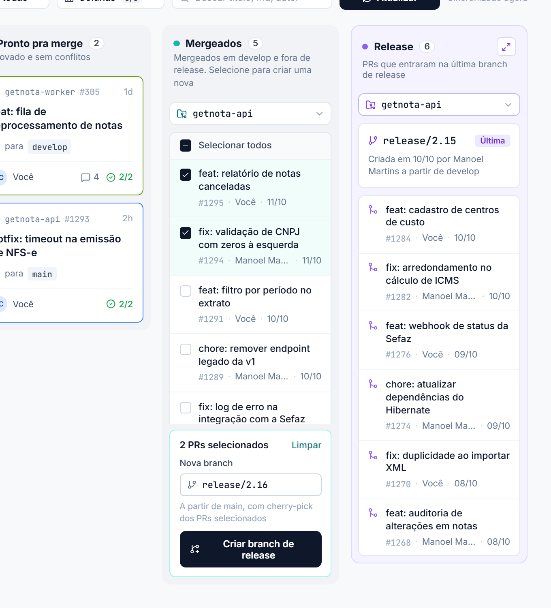
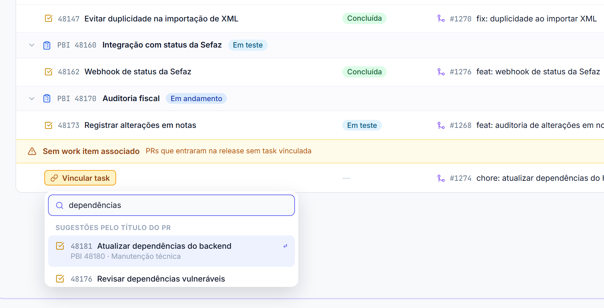
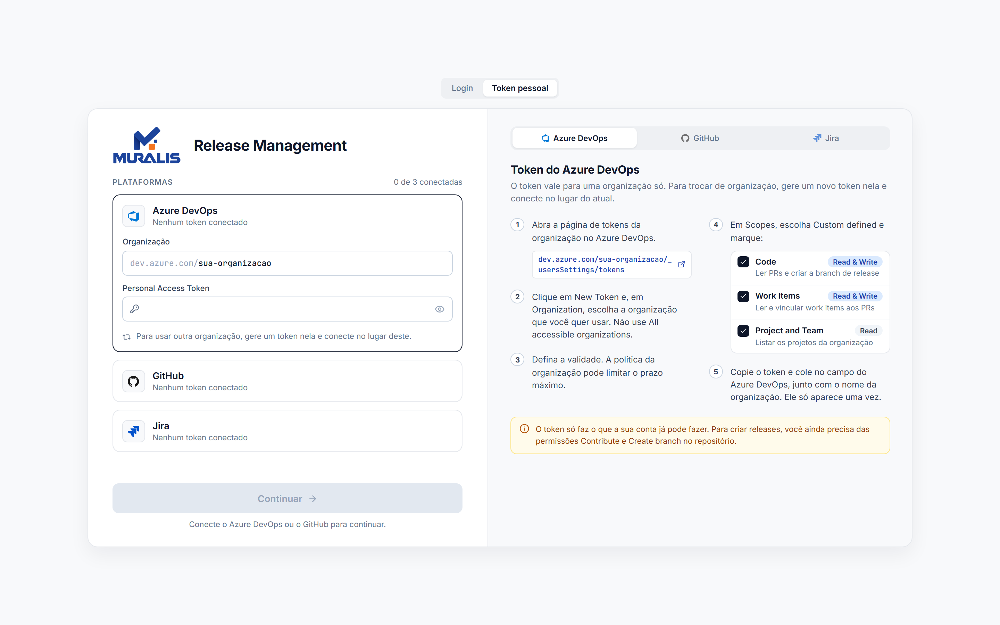
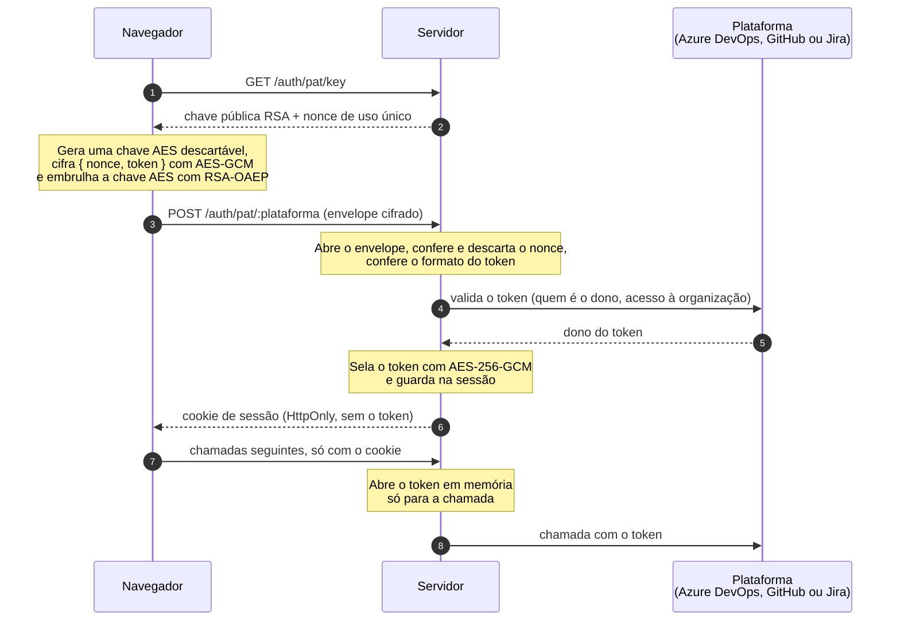
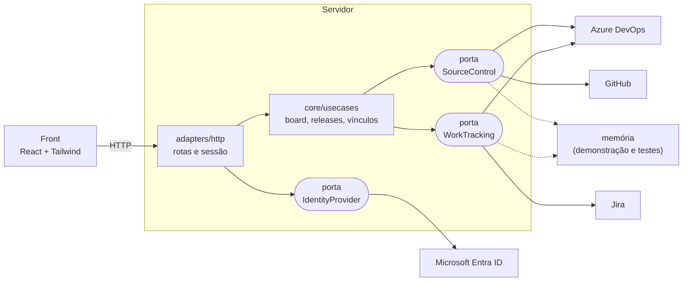

# Release Management

Board de code review e montagem de releases para times que trabalham com vários repositórios. Reúne num só lugar os pull requests que dependem de você, o que já foi mergeado e ainda não entrou em release, e o conteúdo de cada release com as tasks de cada PR.

Os PRs vêm do **Azure DevOps** ou do **GitHub**; as tasks, do **Azure DevOps** ou do **Jira**. A ferramenta não guarda dados dessas plataformas: lê e escreve nelas com a conta de quem está usando, e cada pessoa só enxerga e altera o que as próprias permissões permitem.


## Sumário

- [Para que serve](#para-que-serve)
- [Como funciona na prática](#como-funciona-na-prática)
- [Rodar localmente](#rodar-localmente)
- [Formas de entrar](#formas-de-entrar)
- [Como o token pessoal trafega](#como-o-token-pessoal-trafega)
- [Arquitetura](#arquitetura)
- [Organização do repositório](#organização-do-repositório)
- [Testes](#testes)
- [Documentação relacionada](#documentação-relacionada)

## Para que serve

Num produto com vários repositórios, três perguntas tomam tempo todos os dias:

| Pergunta | Onde a ferramenta responde |
|---|---|
| Que PRs estão esperando por mim? | Coluna **Depende de mim**: PRs em que você é revisor e ainda não votou, e PRs seus em que um revisor pediu mudança. |
| O que já foi mergeado e ainda não saiu em release? | Coluna **Mergeados**: PRs concluídos em `develop` que não estão na base nem nas últimas releases. |
| O que tem dentro desta release? | Coluna **Release** e a tela cheia: PRs da release agrupados por PBI e task, com o estado de cada uma. |

A partir daí ela também faz duas coisas que hoje são manuais:

- **Cria a branch de release** a partir dos PRs escolhidos, com cherry-pick de cada um. Em conflito, nada fica criado pela metade.
- **Vincula a task ao PR** que entrou na release sem vínculo, direto na plataforma de origem.

## Como funciona na prática

### Board

Os PRs abertos do projeto são distribuídos em quatro colunas (Depende de mim, Em revisão, Conflito, Pronto pra merge), ao lado das colunas Mergeados e Release. Os filtros de autor, repositório e destino, a busca e a escolha de colunas visíveis ficam no topo.

Cada repositório pode ganhar uma cor, que vira a borda dos cards dele. Assim dá para reconhecer de longe de onde é cada PR.



### Criar uma release

Na coluna **Mergeados**, marque os PRs e confirme o nome da branch (a sugestão segue o padrão da última release do repositório). A ferramenta aplica os PRs por cherry-pick, na ordem em que foram mergeados, e só cria a branch quando todos passam.



### Release em tela cheia

A release mais recente de cada repositório abre numa tabela com os PRs agrupados por PBI e task, com o estado de cada item. PRs sem task aparecem num bloco de alerta no fim.


Para um PR sem task, **Vincular task** busca os work items pelo título do PR ou pelo que você digitar. O vínculo é gravado na plataforma (Azure DevOps ou Jira) e pode ser desfeito.



## Rodar localmente

Requisitos: Node.js 22 ou mais novo (desenvolvido com a versão 24).

```bash
cd app
npm install
npm run dev
```

Abra http://localhost:5173. Sem nenhuma configuração, a entrada é por token pessoal, informado na própria tela.

Para ver a interface com dados fictícios, sem conectar em plataforma nenhuma:

```bash
AUTH_MODE=demo npm run dev
```

| Comando (em `app/`) | O que faz |
|---|---|
| `npm run dev` | API na porta 3001 e front na 5173, com recarga |
| `npm test` | Testes do servidor |
| `npm run typecheck` | Tipos do servidor e do front |
| `npm run build` e `npm start` | Build do front e API servindo tudo na porta 3001 |
| `npm run chaos -w server` | Teste de caos contra um servidor local |

As variáveis de ambiente estão descritas em [`app/.env.example`](app/.env.example).

## Formas de entrar



- **Token pessoal:** sempre disponível. Cada plataforma tem o próprio token, e o guia de escopos fica na tela de entrada.
  - **Azure DevOps:** organização e Personal Access Token. Fornece os PRs e os work items.
  - **GitHub:** organização (ou usuário) e fine-grained token. Fornece os PRs.
  - **Jira:** site, e-mail da conta e API token. Fornece as tasks dos PRs do GitHub.
- **Conta Microsoft:** aparece quando há um app registration do Microsoft Entra ID configurado. Vale só para o Azure DevOps. O passo a passo está em [`app/README.md`](app/README.md#conectar-ao-azure-devops).

As conexões se somam na mesma sessão. Para abrir o board é preciso o Azure DevOps ou o GitHub; com os dois conectados, o menu de contas escolhe de qual vêm os PRs.

## Como o token pessoal trafega

O token dá acesso à sua conta na plataforma, então o caminho dele é o ponto mais sensível da aplicação. Em resumo: ele sai do navegador cifrado, fica guardado cifrado, e só existe em claro na memória do servidor no instante de chamar a plataforma.



### No envio

1. O navegador pede a chave pública do servidor. A resposta traz também um **nonce**, que vale para um único envio e por dois minutos.
2. O navegador gera uma chave AES-256 descartável e cifra `{ nonce, token }` com AES-GCM. A chave AES é embrulhada com RSA-OAEP (SHA-256) usando a chave pública.
3. Só esse envelope vai no corpo da requisição. O token não aparece em claro no corpo, em logs de proxy nem nas ferramentas de rede do navegador.

O par de chaves RSA é gerado a cada inicialização do servidor e vive só na memória do processo.

### No servidor

1. O envelope é aberto com a chave privada. O nonce precisa existir, estar no prazo e nunca ter sido usado; ele é descartado na hora. Um envelope capturado não pode ser reenviado.
2. O token é conferido (tamanho e apenas caracteres visíveis) e validado na própria plataforma, o que também revela de quem ele é.
3. O token é **selado com AES-256-GCM**, com uma chave derivada do `SESSION_SECRET`, e guardado assim na sessão em memória e no arquivo `.data/sessions.enc`.
4. A cada chamada à plataforma, o token é aberto em memória só para montar o cabeçalho da requisição. Ele nunca é gravado em log nem devolvido ao navegador.

### No navegador

Fica apenas o cookie de sessão: um identificador opaco, assinado, `HttpOnly` e `SameSite=Lax` (e `Secure` em HTTPS). O token não vai para `localStorage` nem para nenhum outro armazenamento.

### O que essa cifra não cobre

A cifra do envio é uma camada a mais, não um substituto do HTTPS. Sem TLS, quem altera o tráfego pode trocar a chave pública, e o cookie de sessão fica exposto. **Em produção, use HTTPS.**

### Outras proteções

- Limite de 60 tentativas de entrada por minuto, por IP.
- Escritas exigem um cabeçalho que outro site não consegue enviar (proteção contra CSRF).
- Cabeçalhos de segurança em toda resposta (Content-Security-Policy, `X-Frame-Options`, `nosniff`, `Referrer-Policy` e, em HTTPS, HSTS).
- Ids de projeto e repositório são validados e codificados antes de entrar no endereço da plataforma.

## Arquitetura

O servidor segue a arquitetura hexagonal: o núcleo define **portas** por capacidade e não conhece nenhuma plataforma. Cada plataforma é um **adapter** que implementa a porta.



| Parte | Tecnologia |
|---|---|
| Servidor | Node.js, TypeScript, Fastify |
| Front | React 19, Vite, Tailwind CSS 4, TanStack Query, Radix UI |
| Validação das respostas da API no front | zod |
| Idiomas | Português, inglês e francês, pelo idioma do navegador |
| Testes | Vitest |

Para adicionar outra plataforma, implemente a porta correspondente em `app/server/src/adapters/` e registre em `registry.ts`. Os detalhes de como a release é montada em cada plataforma estão em [`app/README.md`](app/README.md#como-a-release-é-montada).

## Organização do repositório

```
app/                      aplicação
  server/                 API (Fastify)
    src/core/             domínio, portas e casos de uso
    src/adapters/         Azure DevOps, GitHub, Jira, Entra, sessão, HTTP, memória
    test/                 testes
    chaos.mts             teste de caos
  web/                    front (React)
    src/components/       componentes do board, menus e seletor de cor
    src/pages/            entrada, board e release
    src/locales/          textos em pt, en e fr
design/                   design e material de apresentação
  releaseManagement.pen   arquivo fonte do design (pen.dev)
  releaseManagement-assets/  imagens usadas pelo design
  logos/                  logos dos produtos e da Muralis
  arquitetura.drawio      diagrama de arquitetura
  onboarding/             tour de onboarding em HTML
docs/
  images/                 capturas de tela deste README
  capturar-telas.mjs      roteiro que gera as capturas
```

## Testes

```bash
cd app
npm test                  # testes do servidor
npm run chaos -w server   # teste de caos
```

O teste de caos sobe o servidor localmente e o ataca com parâmetros e corpos hostis, cookies forjados, envelopes de token adulterados, corridas e rajadas. Ele confere que nenhuma resposta é um erro interno, que nada interno vaza e que os cabeçalhos de segurança estão em toda resposta.

Ainda sem teste contra as APIs reais: os adapters do GitHub e do Jira e os caminhos de escrita do Azure DevOps são cobertos só por respostas simuladas.

## Documentação relacionada

- [`app/README.md`](app/README.md): referência técnica da aplicação (configuração do login Microsoft, regras de montagem da release, idiomas, arquitetura em detalhe).
- [`design/onboarding/README.md`](design/onboarding/README.md): como o tour de onboarding é feito e como recapturar as telas.

### Atualizar as capturas deste README

Com a demonstração em `localhost:5174` e a aplicação normal em `localhost:5173`, rode:

```bash
node docs/capturar-telas.mjs docs/images
```

O roteiro usa o Microsoft Edge em modo headless e espera encontrá-lo no caminho padrão do Windows.
