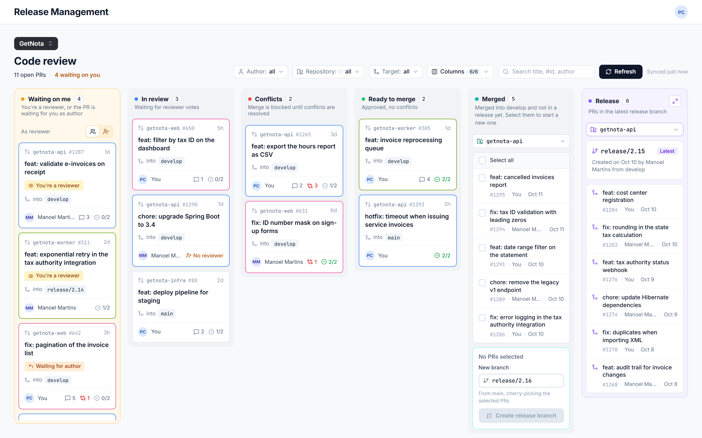
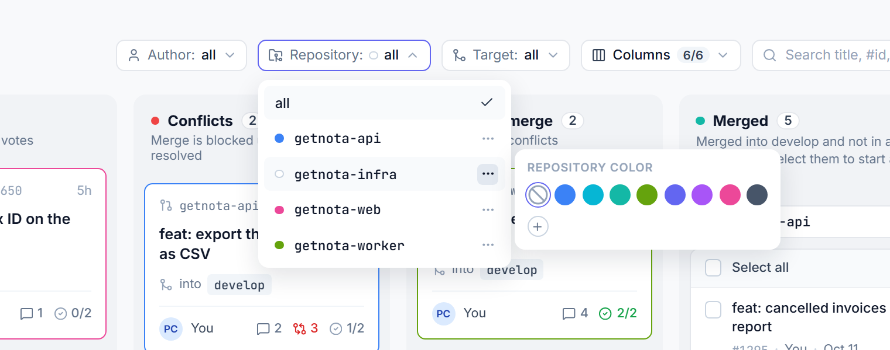
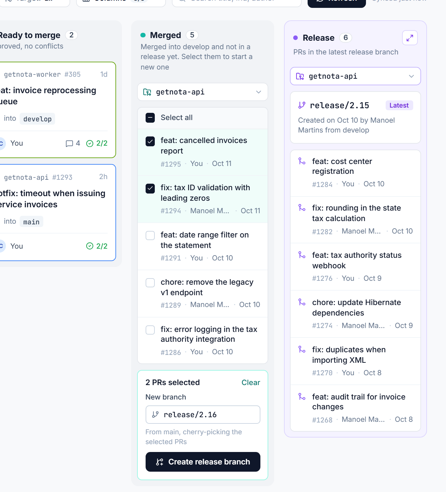
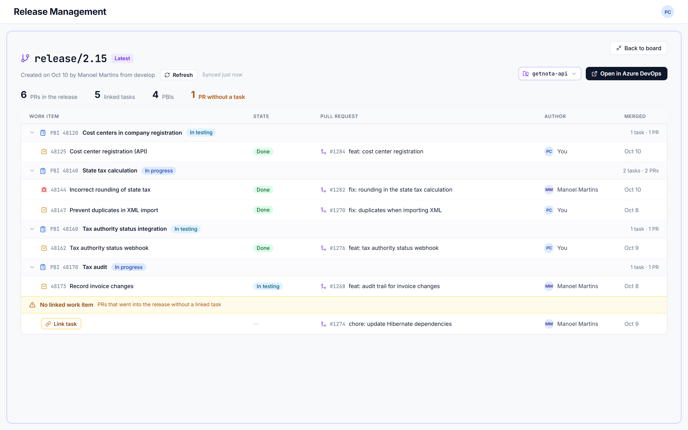
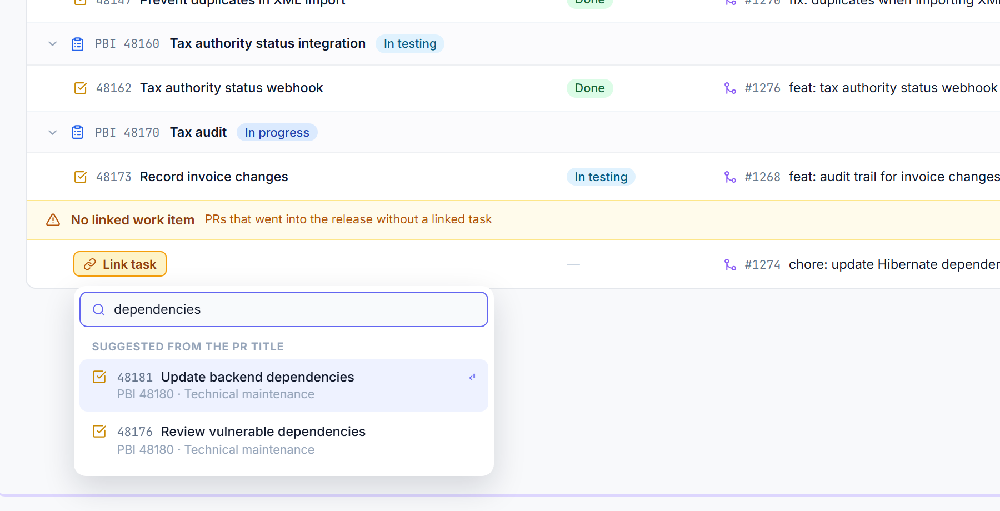
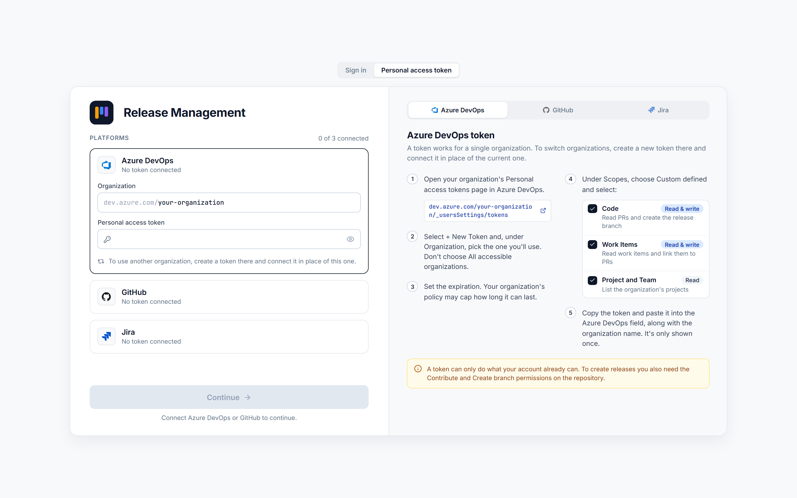
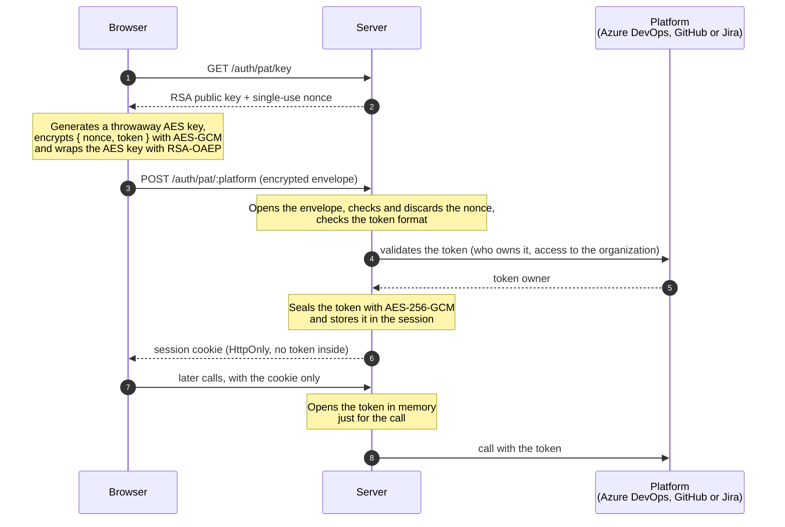
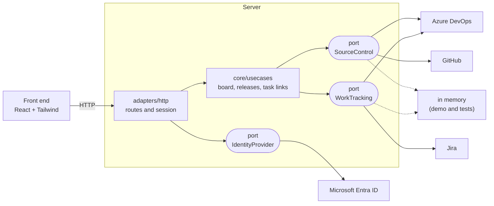

# Release Management

A code review board and release builder for teams that work across many repositories, built for a time when AI writes code faster than people can review it. It brings together the pull requests waiting on you, what has been merged but not yet released, and the contents of each release with the task behind every PR.

Pull requests come from **Azure DevOps** or **GitHub**; tasks come from **Azure DevOps** or **Jira**. The tool doesn't store data from these platforms: it reads and writes to them with the account of whoever is using it, so each person only sees and changes what their own permissions allow.

## Contents

- [What it's for](#what-its-for)
- [How it works](#how-it-works)
- [Signing in](#signing-in)
- [How the personal access token travels](#how-the-personal-access-token-travels)
- [Architecture](#architecture)

## What it's for

### The bottleneck has moved

With AI assistants, writing code got fast. The number of pull requests grew, but the capacity to review them is still that of the same people. The delivery bottleneck is no longer writing code: it's **code review** and the organization around it. That means knowing what is waiting on whom, what can already be merged, and what will actually go into the next release.

The platforms show pull requests one repository at a time. That works with a few PRs a day and stops working once they multiply. This tool exists to give reviewers a single, prioritized queue, and to take the manual work of assembling a release out of the way once review is done.

### The everyday questions

On a product with many repositories, three questions take up time every day:

| Question | Where the tool answers it |
|---|---|
| Which PRs are waiting on me? | The **Waiting on me** column: PRs where you're a reviewer and haven't voted yet, and your own PRs where a reviewer asked for changes. |
| What has been merged but not released yet? | The **Merged** column: PRs completed into `develop` that aren't in the base branch or in the latest releases. |
| What's in this release? | The **Release** column and its full-screen view: the release's PRs grouped by backlog item and task, with the state of each one. |

From there it also does two things that are manual today:

- **Creates the release branch** from the PRs you pick, cherry-picking each one. If there's a conflict, nothing is left half-created.
- **Links a task to a PR** that went into the release without one, directly on the platform it came from.

## How it works

### Board

The project's open PRs are spread across four columns (Waiting on me, In review, Conflicts, Ready to merge), next to the Merged and Release columns. Filters for author, repository and target branch, the search box and the choice of visible columns sit at the top.

Each repository can be given a color, which becomes the border of its cards. That makes it easy to tell at a glance where each PR comes from.

### Creating a release

In the **Merged** column, select the PRs and confirm the branch name (the suggestion follows the pattern of the repository's latest release). The tool cherry-picks the PRs in the order they were merged, and only creates the branch once all of them apply cleanly.

### Release in full screen

The latest release of each repository opens as a table with its PRs grouped by backlog item and task, showing the state of each item. PRs without a task appear in a warning block at the end.

For a PR without a task, **Link task** searches work items by the PR title or by whatever you type. The link is saved on the platform (Azure DevOps or Jira) and can be undone.

## Signing in

- **Personal access token:** always available. Each platform has its own token, and the scope guide is on the sign-in screen.
  - **Azure DevOps:** organization and personal access token. Provides the PRs and the work items.
  - **GitHub:** organization (or user) and fine-grained token. Provides the PRs.
  - **Jira:** site, account email and API token. Provides the tasks for GitHub PRs.
- **Microsoft account:** shown when a Microsoft Entra ID app registration is configured. It only covers Azure DevOps. The step-by-step setup is in [`app/README.md`](app/README.md#connecting-to-azure-devops-with-a-microsoft-account).

Connections add up within the same session. Opening the board requires Azure DevOps or GitHub; with both connected, the account menu chooses which one the PRs come from.

## How the personal access token travels

The token gives access to your account on the platform, so its path is the most sensitive part of the application. In short: it leaves the browser encrypted, is stored encrypted, and only exists in plain text in the server's memory at the moment it calls the platform.

### In transit

1. The browser asks the server for its public key. The response also carries a **nonce**, valid for a single submission and for two minutes.
2. The browser generates a throwaway AES-256 key and encrypts `{ nonce, token }` with AES-GCM. The AES key is wrapped with RSA-OAEP (SHA-256) using the public key.
3. Only that envelope goes in the request body. The token doesn't appear in plain text in the body, in proxy logs or in the browser's network tools.

The RSA key pair is generated every time the server starts and lives only in the process memory.

### On the server

1. The envelope is opened with the private key. The nonce must exist, be within its time limit and never have been used; it is discarded on the spot. A captured envelope can't be sent again.
2. The token is checked (length and visible characters only) and validated on the platform itself, which also reveals who owns it.
3. The token is **sealed with AES-256-GCM**, using a key derived from `SESSION_SECRET`, and stored that way in the in-memory session and in the `.data/sessions.enc` file.
4. On each call to the platform, the token is opened in memory only to build the request header. It is never written to a log or sent back to the browser.

### In the browser

Only the session cookie remains: an opaque, signed identifier, `HttpOnly` and `SameSite=Lax` (and `Secure` over HTTPS). The token doesn't go into `localStorage` or any other storage.

### What this encryption doesn't cover

Encrypting the token in transit is an extra layer, not a replacement for HTTPS. Without TLS, someone who can alter the traffic can swap the public key, and the session cookie is exposed. **Use HTTPS in production.**

### Other protections

- A limit of 60 sign-in attempts per minute, per IP.
- Writes require a header that another site can't send (CSRF protection).
- Security headers on every response (Content-Security-Policy, `X-Frame-Options`, `nosniff`, `Referrer-Policy` and, over HTTPS, HSTS).
- Project and repository ids are validated and encoded before they go into the platform's URL.

## Architecture

The server follows a hexagonal architecture: the core defines **ports** by capability and knows nothing about any platform. Each platform is an **adapter** that implements a port.

| Part | Technology |
|---|---|
| Server | Node.js, TypeScript, Fastify |
| Front end | React 19, Vite, Tailwind CSS 4, TanStack Query, Radix UI |
| Validation of API responses in the front end | zod |
| Languages | Portuguese, English and French, following the browser language |
| Tests | Vitest |
